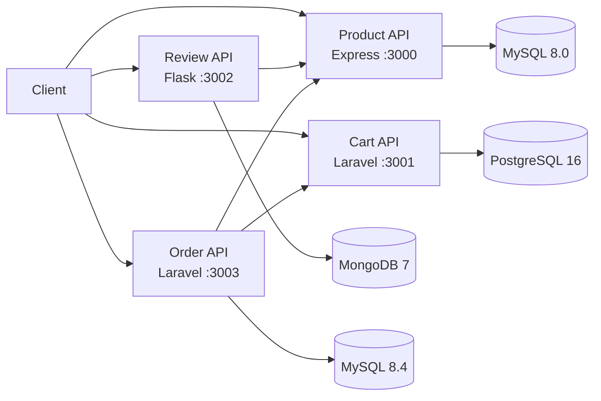

# Microservices E-commerce

Demo e-commerce Product, Cart, Review, dan Order. Tiap service memiliki database
sendiri dan berkomunikasi lewat HTTP. Order memakai routes, Form Request,
controller, service, Eloquent, dan client Cart/Product; UI React/Vite di luar Compose.

## Arsitektur



## Clone dan jalankan seluruh sistem

Prasyarat: Git, Docker Desktop atau Docker Engine, dan Docker Compose v2.
Perintah `docker compose` bisa dijalankan dari PowerShell atau Git Bash. Contoh
`curl` di README memakai sintaks Bash; di Windows jalankan contoh tersebut dari
Git Bash atau WSL, karena `curl` di Windows PowerShell memiliki sintaks berbeda.

```sh
git clone https://github.com/dzaki09-code/MicroServices.git
cd MicroServices
docker compose up --build -d
docker compose ps
```

Tunggu sampai service/database dengan health check berstatus `healthy`.
`review-service` tidak memiliki health check Compose; pastikan statusnya
`running`, lalu cek keempat API:

```sh
curl http://localhost:3000/health
curl http://localhost:3001/up
curl http://localhost:3002/health
curl http://localhost:3003/health
```

Compose menjalankan migrasi Cart dan Order saat container mulai. Product
menginisialisasi tabel dan tiga produk contoh ketika volume database pertama
kali dibuat. Log: `docker compose logs -f [nama-service]`. Matikan stack tanpa
menghapus data dengan `docker compose down`; `docker compose down -v`
menghapus seluruh volume database.

### UI (opsional)

UI React/Vite tidak termasuk Compose dan saat ini hanya berupa halaman demo,
belum terhubung ke API. Untuk menjalankannya terpisah, gunakan Node.js
`^20.19.0` atau `>=22.12.0` dan jalankan dari root repository:

```sh
cd ecommerce-ui
npm ci
npm run dev -- --host 0.0.0.0
```

Buka `http://localhost:5173`. Perintah ini hanya menjalankan UI demo; backend
tetap dijalankan melalui Docker Compose seperti langkah di atas.

## API

Base URL: Product `http://localhost:3000`, Cart `:3001`, Review `:3002`,
Order `:3003`. Kirim body JSON dengan `Content-Type: application/json`.
Contoh memakai `curl`; ganti ID sesuai respons API.

### Product

| Method | Path | Keterangan |
|---|---|---|
| GET | `/health` | Health |
| GET | `/products` | Daftar produk |
| GET | `/products/{id}` | Detail produk |
| POST | `/products` | Buat produk |
| PUT | `/products/{id}` | Ganti produk |
| DELETE | `/products/{id}` | Hapus produk |

```sh
curl http://localhost:3000/products
curl http://localhost:3000/products/1
curl -X POST http://localhost:3000/products -H "Content-Type: application/json" \
  -d '{"name":"Keyboard","description":"Mekanik","price":500000,"stock":10,"image":"iVBORw0KGgoAAAANSUhEUgAAAAEAAAABCAQAAAC1HAwCAAAAC0lEQVR42mP8/x8AAwMCAO+/F2sAAAAASUVORK5CYII="}'
curl -X PUT http://localhost:3000/products/1 -H "Content-Type: application/json" \
  -d '{"name":"Keyboard","description":"Mekanik","price":500000,"stock":10,"image":"iVBORw0KGgoAAAANSUhEUgAAAAEAAAABCAQAAAC1HAwCAAAAC0lEQVR42mP8/x8AAwMCAO+/F2sAAAAASUVORK5CYII="}'
curl -X DELETE http://localhost:3000/products/1
```

`name`, `price`, `stock`, dan Base64 `image` wajib; gambar maksimal 2 MiB.

### Cart

| Method | Path | Keterangan |
|---|---|---|
| GET | `/up` | Health Laravel |
| GET | `/carts/{userId}` | Lihat cart |
| POST | `/carts` | Tambah item |
| PUT | `/carts/items/{id}` | Ubah jumlah item |
| DELETE | `/carts/items/{id}` | Hapus item |
| DELETE | `/carts/{userId}` | Kosongkan cart |

```sh
curl http://localhost:3001/carts/42
curl -X POST http://localhost:3001/carts -H "Content-Type: application/json" \
  -d '{"user_id":42,"product_id":1,"quantity":2}'
curl -X PUT http://localhost:3001/carts/items/1 -H "Content-Type: application/json" -d '{"quantity":3}'
curl -X DELETE http://localhost:3001/carts/items/1
curl -X DELETE http://localhost:3001/carts/42
```

ID pengguna/produk dan jumlah harus bilangan bulat positif. `quantity` saat
menambah item opsional (default 1); produk yang sama menambah jumlah item.

### Review

| Method | Path | Keterangan |
|---|---|---|
| GET | `/health` | Health |
| GET | `/reviews/product/{productId}` | Ulasan dan ringkasan rating |
| GET | `/reviews/{reviewId}` | Detail ulasan |
| POST | `/reviews` | Buat ulasan |
| PUT | `/reviews/{reviewId}` | Ubah rating/komentar |
| DELETE | `/reviews/{reviewId}` | Hapus ulasan |

```sh
curl -X POST http://localhost:3002/reviews -H "Content-Type: application/json" \
  -d '{"product_id":1,"user_id":42,"rating":5,"comment":"Sesuai deskripsi"}'
curl http://localhost:3002/reviews/product/1
curl http://localhost:3002/reviews/REVIEW_ID
curl -X PUT http://localhost:3002/reviews/REVIEW_ID -H "Content-Type: application/json" -d '{"rating":4,"comment":"Bagus"}'
curl -X DELETE http://localhost:3002/reviews/REVIEW_ID
```

Rating bilangan bulat 1–5; komentar opsional, maksimal 1000 karakter.
`reviewId` adalah MongoDB ObjectId; satu pengguna hanya boleh mengulas produk
yang sama sekali.

### Order

| Method | Path | Keterangan |
|---|---|---|
| GET | `/health` | Health |
| GET | `/orders` | Semua pesanan |
| POST | `/orders` | Checkout |
| GET | `/orders/{id}` | Detail pesanan |
| GET | `/orders/user/{userId}` | Pesanan pengguna |
| GET | `/orders/user/{userId}?status=PENDING` | Filter status (`PENDING`/`PAID`) |
| PATCH | `/orders/{id}/pay` | Tandai pesanan dibayar |

```sh
curl -X POST http://localhost:3003/orders -H "Content-Type: application/json" -d '{"user_id":42}'
curl http://localhost:3003/orders
curl http://localhost:3003/orders/1
curl "http://localhost:3003/orders/user/42?status=PENDING"
curl -X PATCH http://localhost:3003/orders/1/pay
```

Checkout memerlukan `user_id` positif, membaca cart dan produk/stok,
menyimpan order `PENDING`, lalu mengosongkan cart. Pembayaran hanya menerima
order `PENDING`. Respons berupa JSON; status error umum: `400`/`422`
(validasi), `404` (tidak ditemukan), `409` (konflik), `413` (body terlalu
besar), `500` (kesalahan internal), `503` (service dependen).

## Environment variable

Compose menetapkan variabel di bawah; `PORT` Product API bersifat opsional
(default `3000`) dan tidak ditetapkan Compose. Clone baru tidak perlu membuat
`.env`. Credential yang ada di `docker-compose.yml` hanya untuk demonstrasi
lokal. Nama host database/service hanya berfungsi di network Compose.

| Container | Variabel |
|---|---|
| Product API | `DB_HOST`, `DB_USER`, `DB_PASSWORD`, `DB_NAME`; `PORT` opsional (default `3000`) |
| Product DB | `MYSQL_DATABASE`, `MYSQL_USER`, `MYSQL_PASSWORD`, `MYSQL_ROOT_PASSWORD` |
| Cart API | `DB_CONNECTION`, `DB_HOST`, `DB_PORT`, `DB_DATABASE`, `DB_USERNAME`, `DB_PASSWORD`, `PRODUCTS_SERVICE_URL`, `LOG_CHANNEL` |
| Cart DB | `POSTGRES_DB`, `POSTGRES_USER`, `POSTGRES_PASSWORD` |
| Review API | `HOST`, `PORT`, `FLASK_DEBUG`, `MONGO_URI`, `MONGO_DB_NAME`, `PRODUCT_SERVICE_URL` |
| Review DB | `MONGO_INITDB_ROOT_USERNAME`, `MONGO_INITDB_ROOT_PASSWORD` |
| Order API | `APP_ENV`, `APP_DEBUG`, `APP_URL`, `LOG_CHANNEL`, `CACHE_STORE`, `SESSION_DRIVER`, `QUEUE_CONNECTION`, `DB_CONNECTION`, `DB_HOST`, `DB_PORT`, `DB_DATABASE`, `DB_USERNAME`, `DB_PASSWORD`, `CART_SERVICE_URL`, `PRODUCT_SERVICE_URL` |
| Order DB | `MYSQL_DATABASE`, `MYSQL_USER`, `MYSQL_PASSWORD`, `MYSQL_ROOT_PASSWORD` |

`product-service/.env.example`: `PORT`, `DB_HOST`, `DB_USER`, `DB_PASSWORD`, `DB_NAME`.
`.env.example` Cart/Order memuat variabel Laravel tambahan: `APP_NAME`, `APP_ENV`,
`APP_KEY`, `APP_DEBUG`, `APP_URL`, `APP_LOCALE`, `APP_FALLBACK_LOCALE`,
`APP_FAKER_LOCALE`, `APP_MAINTENANCE_DRIVER`, `BCRYPT_ROUNDS`, `LOG_CHANNEL`,
`LOG_STACK`, `LOG_DEPRECATIONS_CHANNEL`, `LOG_LEVEL`, `DB_CONNECTION`,
`DB_HOST`, `DB_PORT`, `DB_DATABASE`, `DB_USERNAME`, `DB_PASSWORD`,
`SESSION_DRIVER`, `SESSION_LIFETIME`, `SESSION_ENCRYPT`, `SESSION_PATH`,
`SESSION_DOMAIN`, `BROADCAST_CONNECTION`, `FILESYSTEM_DISK`,
`QUEUE_CONNECTION`, `CACHE_STORE`, `CACHE_PREFIX`, `MEMCACHED_HOST`,
`REDIS_CLIENT`, `REDIS_HOST`, `REDIS_PASSWORD`, `REDIS_PORT`, `MAIL_MAILER`,
`MAIL_SCHEME`, `MAIL_HOST`, `MAIL_PORT`, `MAIL_USERNAME`, `MAIL_PASSWORD`,
`MAIL_FROM_ADDRESS`, `MAIL_FROM_NAME`, `AWS_ACCESS_KEY_ID`,
`AWS_SECRET_ACCESS_KEY`, `AWS_DEFAULT_REGION`, `AWS_BUCKET`,
`AWS_USE_PATH_STYLE_ENDPOINT`, `VITE_APP_NAME`, `CART_SERVICE_URL`, `PRODUCT_SERVICE_URL`.

## Keputusan desain dan keterbatasan

- Database dipisah per service; integrasi antarlayanan lewat HTTP, bukan akses
  database silang. Compose memakai health check/dependensi untuk startup, tetapi
  layanan dependen masih dapat berhenti setelah aplikasi berjalan.
- Cart tidak memvalidasi produk melalui Product API (meski URL tersedia).
- Checkout memeriksa stok tetapi tidak mengurangi/mengunci stok; stok dapat
  berubah sebelum pesanan diproses.
- Pembayaran hanya mengubah status, tanpa payment gateway. Jika cart gagal
  dikosongkan setelah order tersimpan, API dapat mengembalikan `503`; periksa
  daftar order sebelum mengulangi checkout.
- Tidak ada autentikasi/otorisasi; `user_id` berasal dari request. Bukan untuk
  deployment publik tanpa pengamanan.
- Data contoh Product hanya dimasukkan saat volume database pertama dibuat; UI belum terintegrasi dengan Compose/API.
